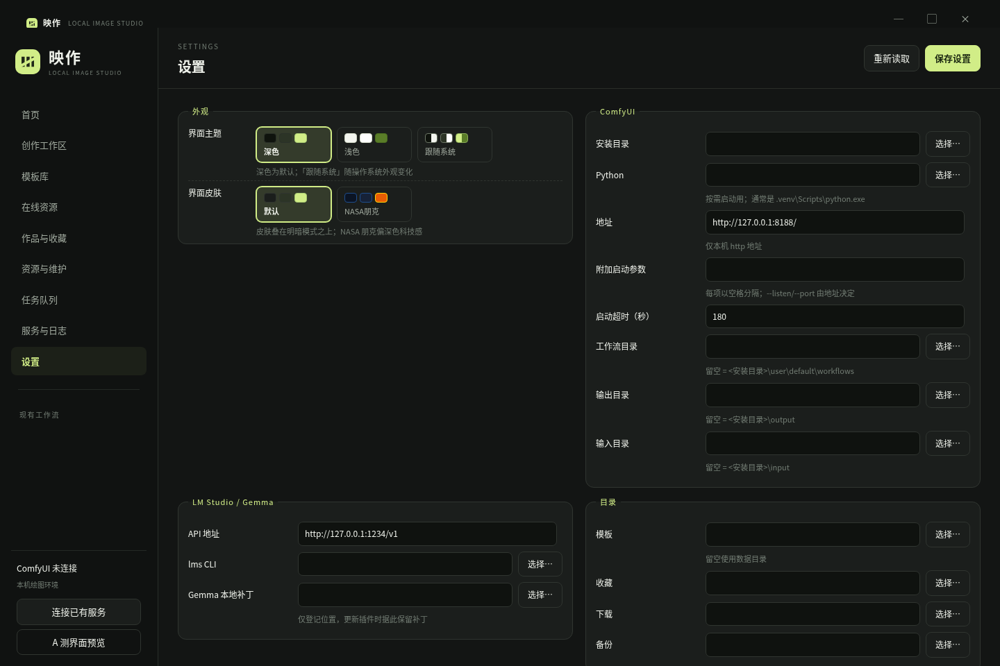
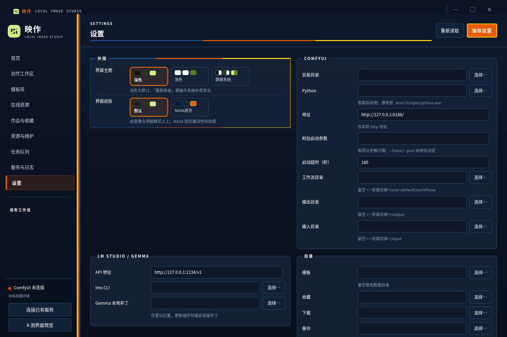
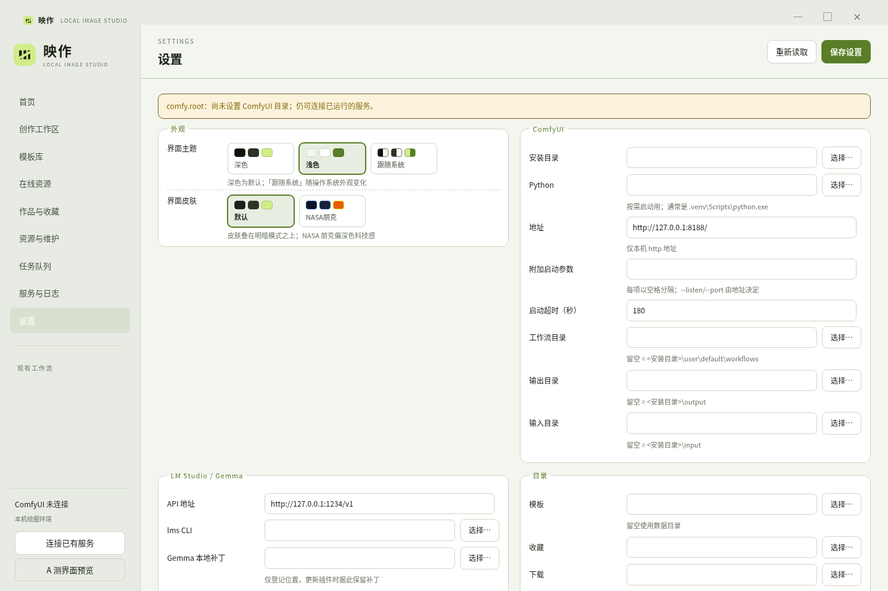

# UI 截图（静态预览）

由 `desktop/workbench.html` 静态托管 + Puppeteer 截取（1440×960）。主题/皮肤通过 `document.documentElement.dataset.theme` / `dataset.skin` 切换；IPC 用演示数据桩填充设置、首页服务卡片与空状态。

## 默认皮肤 · 深色（`ui.theme=dark`，`ui.skin=default`）

| 页面 | 文件 |
| --- | --- |
| 首页 | [default-home.png](./default-home.png) |
| 创作工作区 | [default-create.png](./default-create.png) |
| 创作 · 起始页 | [default-create-start.png](./default-create-start.png) |
| 模板库 | [default-templates.png](./default-templates.png) |
| 在线资源 | [default-online.png](./default-online.png) |
| 作品与收藏 | [default-assets.png](./default-assets.png) |
| 资源与维护 | [default-resources.png](./default-resources.png) |
| 任务队列 | [default-queue.png](./default-queue.png) |
| 服务与日志 | [default-services.png](./default-services.png) |
| 设置 | [default-settings.png](./default-settings.png) |

## NASA 朋克皮肤 · 深色（`ui.skin=nasa-punk`）

| 页面 | 文件 |
| --- | --- |
| 首页 | [nasa-home.png](./nasa-home.png) |
| 创作工作区 | [nasa-create.png](./nasa-create.png) |
| 创作 · 起始页 | [nasa-create-start.png](./nasa-create-start.png) |
| 模板库 | [nasa-templates.png](./nasa-templates.png) |
| 在线资源 | [nasa-online.png](./nasa-online.png) |
| 作品与收藏 | [nasa-assets.png](./nasa-assets.png) |
| 资源与维护 | [nasa-resources.png](./nasa-resources.png) |
| 任务队列 | [nasa-queue.png](./nasa-queue.png) |
| 服务与日志 | [nasa-services.png](./nasa-services.png) |
| 设置 | [nasa-settings.png](./nasa-settings.png) |

## 默认皮肤 · 浅色（`ui.theme=light`，`ui.skin=default`）

| 页面 | 文件 |
| --- | --- |
| 首页 | [light-home.png](./light-home.png) |
| 创作工作区 | [light-create.png](./light-create.png) |
| 创作 · 起始页 | [light-create-start.png](./light-create-start.png) |
| 模板库 | [light-templates.png](./light-templates.png) |
| 在线资源 | [light-online.png](./light-online.png) |
| 作品与收藏 | [light-assets.png](./light-assets.png) |
| 资源与维护 | [light-resources.png](./light-resources.png) |
| 任务队列 | [light-queue.png](./light-queue.png) |
| 服务与日志 | [light-services.png](./light-services.png) |
| 设置 | [light-settings.png](./light-settings.png) |

## 预览（设置页）

### 深色默认

### NASA 朋克

### 浅色默认

